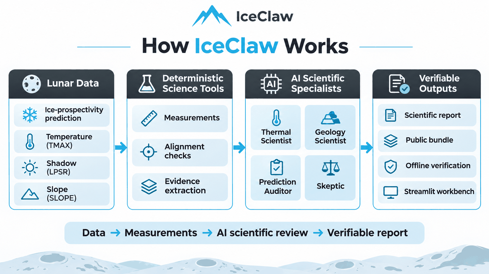
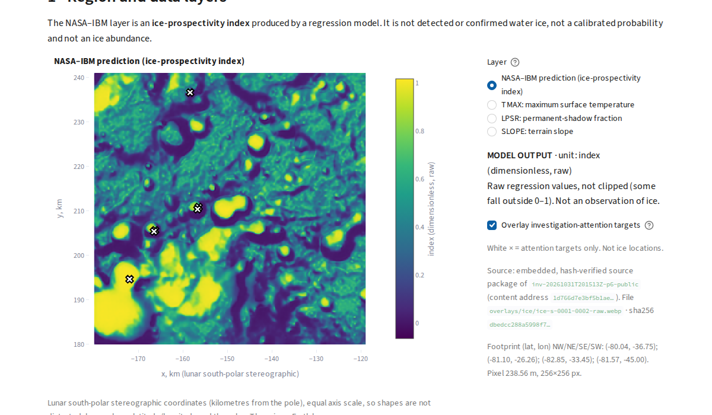

# IceClaw

**AI scientists for verifiable lunar ice research.**

**IceClaw accelerates lunar ice discovery by automating time-consuming scientific analysis, helping
researchers verify predictions faster and prioritize the most promising locations for future
missions.**

IceClaw is a research workbench in which four AI scientific specialists audit a real NASA–IBM
lunar ice-prospectivity prediction against real lunar observations. Every number they rely on comes
from a deterministic scientific tool, and the whole investigation can be downloaded and
independently re-checked offline. Built for [ScienceClaw 2026](https://scienceclawhack.ai/#competition).

> **Scientific honesty.** IceClaw does not confirm water ice or measure a physical probability of
> ice. The NASA–IBM output is a model's *prospectivity index*, and IceClaw's ranking of locations
> reflects investigative scrutiny, not validated ice prospectivity. Prioritizing future mission
> locations is the intended research use; it has not been experimentally demonstrated.

## The problem

AI models can now produce lunar ice-prospectivity maps, but a scientist still has to check each
prediction against the evidence: Is the region actually cold? Is it permanently shadowed? What does
the terrain look like? Are the layers geographically aligned, in the right units, free of corrupted
values? Doing this by hand is slow and repetitive, and any conclusion needs provenance that someone
else can reproduce.

## What IceClaw does

1. **Analyze** — compares the published NASA–IBM ice-prospectivity prediction for a lunar
   south-polar region with co-registered maximum temperature (TMAX), permanently-shadowed-region
   (LPSR) and terrain slope (SLOPE) observations.
2. **Investigate** — four AI scientific specialists run real measurements, publish hypotheses that
   cite them, record alternative explanations and open questions, and may cross-check each other.
3. **Verify** — exports a portable evidence bundle; anyone can recompute every measurement from the
   embedded source rasters offline, without an API key.

## How IceClaw works



**Lunar data → deterministic scientific measurements → four AI specialists → verifiable scientific report.**

* **Lunar data.** The NASA–IBM Lunar Foundation Model's published ice-prospectivity output for tile
  `ice-s-0001-0002` (from the MOONATLAS science example) and the same tile's SomBench TMAX (K),
  LPSR (shadow fraction) and SLOPE (deg) layers. Every file is checksum-verified; geographic
  alignment between prediction and observations is validated before use.
* **Deterministic science tools.** Value ranges, quantiles, missing data, gradients and
  discontinuities, edge behaviour, PSR-versus-temperature consistency and slope statistics. Agents
  can only call these tools; they cannot invent numbers.
* **Four AI specialists** (Microsoft Agent Framework, OpenAI `gpt-6-luna`): the **Thermal
  Scientist**, **Geology Scientist**, **Prediction Auditor** and **Skeptic**. They work
  concurrently, each with its own layers and tools, and share evidence through an append-only
  event history (SQLite) with linked citations; requests, challenges and revisions are possible
  when the evidence warrants them.
* **Verifiable outputs.** A scientific report, an evidence file, the full event log, and a
  public-redacted bundle. The offline verifier recomputes every measurement and re-derives the
  report; it does **not** prove that a language model wrote the text, and it does not confirm ice.
  The **Streamlit workbench** shows all of this on one page.

## See it running



*The real prediction layer on the Streamlit workbench. The white markers are locations the agents'
measurements examined (investigation attention), not ice detections.*
More screenshots and a full page description: [docs/WORKBENCH.md](docs/WORKBENCH.md).

| | **Recorded investigation** (default) | **New live investigation** |
| --- | --- | --- |
| What it is | A real earlier run (19 model calls), saved as a public bundle and replayed | A fresh run of the four specialists |
| Model calls | **None** — clearly labelled `RECORDED INVESTIGATION` | Real, paid OpenAI calls (≤ 28 calls, ≤ 150k input tokens) |
| How it starts | On page load | Only after ticking a cost confirmation and clicking **Investigate**; never on refresh |
| Needs | The public bundle in `runs/` | Local source data + OpenAI configuration |

## Quickstart (WSL / Linux, Python 3.11 or 3.12)

```bash
git clone https://github.com/samat2003/IceClaw.git && cd IceClaw
python3 -m venv .venv && source .venv/bin/activate
python -m pip install -e ".[dev]"          # or: make install
python -m pytest -q                         # offline; no key needed (or: make check)
python -m streamlit run app.py              # or: make ui  →  open http://localhost:8501
```

**A fresh clone contains no data and no recorded runs** — `data/` and `runs/` are deliberately
ignored by Git. Without them, tests that need real data skip, and the app starts but reports
"No regions are available". To enable each part:

* **Recorded demo:** copy the public bundle folder `inv-20261031T201513Z-p6-public` (≈ 1.1 MB,
  public-redacted, attribution included) from a trusted copy into `runs/`, then check it:
  `python -m iceclaw.cli verify --run inv-20261031T201513Z-p6-public` → `RESULT: VERIFIED (26 passed …)`.
  Copy only this `-public` bundle — never a private bundle or `.env`.
* **Region catalog and live investigations:** install the pinned MOONATLAS checkout into
  `.upstream/moonatlas-science` ([docs/UPSTREAM_MOONATLAS.md](docs/UPSTREAM_MOONATLAS.md)), download
  the public SomBench inputs after installing the optional preparation dependency
  (`python -m pip install -e ".[prepare]"`) with
  `python scripts/prepare_sombench.py --patches-from-split test --pole south --layers inputs`
  ([docs/SOMBENCH_INGESTION.md](docs/SOMBENCH_INGESTION.md)), and set `OPENAI_API_KEY`,
  `ICECLAW_LLM_MODEL=gpt-6-luna`, `ICECLAW_LLM_PROVIDER=openai` in your environment or a local
  `.env` (template: `.env.example`, placeholders only).

## Reproducibility

### Multi-robot simulation demo

**Adaptive version:** select **Adaptive Mission** in the sidebar. It automatically queries the
public Sentinel-2 catalog and maps recent scene footprints for the selected Earth region,
refreshing every 60 seconds while open. No uploads or API key are needed. Agents review actual
scene acquisition time and cloud metadata and hand off image-analysis tasks for suitable scenes.
This is online scene discovery and quality triage, not pixel-level ice detection or a lunar feed.
Agents also seek complementary resources automatically: they inspect the live collection
registry, prioritize radar when optical coverage is poor, check regional item availability,
and hand found sources to a resource auditor and planner. Discovery refreshes every 10 minutes;
the page shows reasons, access/license metadata and validation status for each result.
Select **Offline replay** to scrub the simulated mission tick. Hazard, temperature, index and robot-fault
messages change target eligibility and rover assignments. Three policy agents lease analysis,
audit, planning, recovery and sampling roles as tasks arrive; the synchronized map, role table
and evidence-linked decision log show each handoff. Download the example JSON, change its
readings, and upload it to compare the decisions. See [adaptive mission details](docs/ADAPTIVE_MISSION.md).

Run `python -m streamlit run app.py`, open **Robot Simulation** in the sidebar, and
press **Play** below the plot. The default synthetic scenario works without downloaded
data or an API key: three rovers follow rule-based agent dispatch, travel to targets,
and perform mock sampling. Adjust robot count and travel budget; download the JSON action log.
A locally available verified investigation bundle can supply screened follow-up pixels instead.
These are not confirmed ice locations. This toy grid simulation has no terrain navigation,
collision avoidance, return-to-base, physical sampling or ice assay; it makes no model calls.

Validate with `python -m pytest tests/test_robot_sim.py -q` (motion, assignment,
arrival before sampling, travel budgets, repeatability, and a Streamlit page smoke test).

Each bundle contains the event history, every recorded measurement, the report, the ranking table,
the model-usage record and a content-addressed copy of the exact source rasters. The verifier
recomputes every measurement from those rasters within declared tolerances, re-derives the
evidence, report and ranking from the events, checks hashes, units, geometry and event references,
and warns when agent statements assert unsupported ice detections.

```bash
python -m iceclaw.cli verify  --run inv-20261031T201513Z-p6-public   # offline; no key, no GPU
python -m iceclaw.cli replay  --run inv-20261031T201513Z-p6-public   # saved events only; 0 model calls
python -m iceclaw.cli list-regions                                    # needs the local catalog data
python -m iceclaw.cli investigate --region ice-s-0001-0002            # LIVE, paid
python -m iceclaw.cli publish --run <private-bundle>                  # public-redacted copy; no model call
```

The public bundle omits provider-opaque reasoning data and the internal run database; the
workbench offers only public bundles for download. Details:
[docs/INVESTIGATION_BUNDLE.md](docs/INVESTIGATION_BUNDLE.md).

## Research follow-up screening (deterministic)

Beyond the attention ranking, IceClaw can screen the paired tile pixel by pixel with a transparent,
analyst-chosen rule (permanent shadow, TMAX ≤ 110 K, slope ≤ 15°, and a prediction at or above the
tile's 90th percentile) and list **follow-up screening windows** and separate **model–observation
review windows**. On the real tile this gives 16 follow-up windows (195 of 65,536 pixels) and 8
review windows; the count depends strongly on the temperature threshold (10–32 windows for
100–120 K). It is reproducible offline (`iceclaw triage` / `verify-triage`) and is a screen for
human follow-up, **not** an ice detection, probability, or validated site ranking. An optional,
paid, explicitly confirmed review of one window by the four specialists reuses the same agent
runtime; it has so far been tested only with scripted providers. Details:
[docs/TRIAGE_REVIEW.md](docs/TRIAGE_REVIEW.md).

## Evaluation: does agent communication help?

A pre-registered experiment ([docs/BENCHMARK_P7.md](docs/BENCHMARK_P7.md)) gave each approach the
same total budget per case (16 model calls, 16 tool calls, 64k input tokens) on six frozen cases —
2 clean copies and 4 synthetic faults built from the one real paired tile — with outputs frozen
before the answers were revealed.

| Approach | Faults found | F1 | Tokens |
| --- | ---: | ---: | ---: |
| Deterministic rules | 3/4 | 0.857 | 0 |
| Single generalist agent | 2/4 | 0.667 | 170,586 |
| Four isolated specialists | 3/4 | 0.857 | 293,612 |
| Four communicating specialists | 2/4 | 0.667 | 351,538 |

No approach raised a false alarm. The communicating specialists left one case incomplete (two
missing individual verdicts). **The experiment did not show an advantage from agent
communication**: no challenge, revision or verdict change occurred, and communication used the
most tokens. Six synthetic cases from one tile, one run each — no generalization. Scored summaries,
configurations, the pre-registration and frozen-output hashes are in
[docs/p7_results/](docs/p7_results/) and [benchmarks/](benchmarks/).

What IceClaw demonstrably provides is automated, source-backed scientific measurement, transparent
AI hypotheses, and evidence that anyone can verify independently.

## Limitations and scientific integrity

* **One fully paired region** (`ice-s-0001-0002`). **Eleven further south-polar tiles** have
  verified observations but no prediction; the app lists them as unavailable and never invents one.
* The prediction is the **published upstream output**, not a newly executed NASA–IBM model inference.
* Benchmark faults are **synthetic**; nothing here is a verified ice detection.
* The investigation-attention ranking counts scrutiny; it is **not** a physical ice probability.
* No statistically generalizable claim of one approach's superiority is made.
* The live-investigation button is tested offline but has not yet been exercised by a real click.

## Technical documentation

The following documents describe the **working system and its reproducible evidence**, rather
than historical development plans:

* **Data provenance:** [MOONATLAS published prediction](docs/UPSTREAM_MOONATLAS.md) and
  [SomBench source ingestion, units and pairing](docs/SOMBENCH_INGESTION.md).
* **Scientific analysis:** [Lunar research triage and targeted review](docs/TRIAGE_REVIEW.md)
  and [evaluation methodology](docs/EVALUATION_PROTOCOL.md).
* **System and verification:** [Agent runtime](docs/AGENT_RUNTIME.md),
  [investigation bundles and offline verification](docs/INVESTIGATION_BUNDLE.md),
  and [scientist workbench](docs/WORKBENCH.md).
* **Measured results:** [Pre-registered agent comparison](docs/BENCHMARK_P7.md),
  [evaluation outputs](docs/p7_results/), and [benchmark configurations](benchmarks/).

## Credits and sources

* [NASA–IBM Lunar Foundation Model](https://github.com/NASA-IMPACT/NASA-IBM-Lunar-Foundation-Model) (Apache-2.0) — the ice-prospectivity model whose published output is audited. Fraccaro, P. et al. (2026), *Multimodal-Multiresolution Foundation Model for Lunar Remote Sensing*, NASA-IBM AI4Science.
* [MOONATLAS Science](https://github.com/RRG1312/moonatlas-science) — an independent project that published and georeferenced the example prediction (pinned commit `945fb51`).
* [SomBench Ice-Prospectivity-Regression](https://huggingface.co/datasets/nasa-ibm-ai4science/Sombench-Ice-Prospectivity-Regression) (CC BY 4.0) — the TMAX, LPSR and SLOPE observations (pinned revision `78040503`).
* [Microsoft Agent Framework](https://github.com/microsoft/agent-framework) — the runtime of the four AI specialists (OpenAI provider).

IceClaw is not affiliated with or endorsed by NASA, IBM, MOONATLAS or Microsoft. Stack: Python,
NumPy, Rasterio, Pillow, Pydantic, SQLite, Microsoft Agent Framework, Streamlit and Plotly. No
license file has been added yet.
