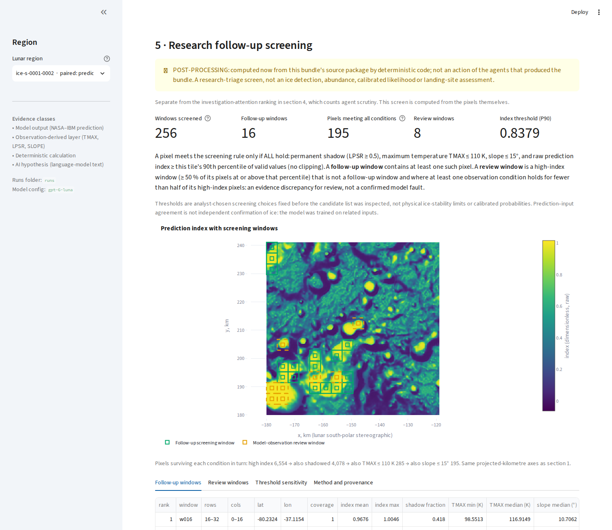

# Research follow-up screening and targeted cross-modal review

Two bounded additions to IceClaw. Neither changes the bundle contract (`iceclaw-bundle/1` and `/2`
and their verifier), the frozen P7 experiments, or any saved investigation.

1. **Deterministic research triage** — a pure, reproducible screen of the verified paired tile
   (prediction + TMAX + LPSR + SLOPE) that produces source-backed *follow-up screening windows* and
   *model–observation review windows*. No model call.
2. **Targeted cross-modal review** (optional, paid) — the four Microsoft Agent Framework
   specialists review ONE window together through the existing runtime, tools, citation rules and
   append-only event store.

**What this is not.** Nothing here detects ice, estimates abundance, gives a calibrated likelihood,
assesses landing safety or validates a site ranking. The thresholds are analyst-chosen screening
choices. The NASA–IBM model was trained on related modalities, so agreement between the prediction
and these observation layers is **not** independent confirmation of ice. The existing
investigation-attention ranking is unchanged and separate.

## 1. Deterministic triage (`science/triage.py`, `reports/triage_artifact.py`)

* **Grid:** non-overlapping 16 × 16 native-pixel windows (256 windows on the 256 × 256 tile). No
  resampling; geographic centre and footprint come from the original projection
  (`moonatlas_adapter.pixel_to_lat_lon`); source hashes, units, coverage masks and non-finite
  pixels are respected (a pixel counts only if covered and finite in all four layers).
* **Per-pixel rule (declared before the candidate list was inspected):**
  `LPSR ≥ 0.5` AND `TMAX ≤ 110 K` AND `SLOPE ≤ 15°` AND `prediction ≥ tile P90` (90th percentile of
  valid raw values, linear interpolation, no clipping). All comparisons are inclusive.
* **Follow-up screening windows:** windows with ≥ 1 qualifying pixel, ordered by qualifying-pixel
  count (descending) then window id (ascending).
* **Model–observation review windows:** not follow-up windows; ≥ 50 % of valid pixels high-index;
  and at least one of {shadow, cold, gentle} holds for fewer than half of the high-index pixels.
  Ordered by high-index fraction then window id. These are **evidence discrepancies for review,
  not confirmed model faults**.
* **If nothing qualifies** the result says so and no threshold is changed (tested).
* **Sensitivity** (predeclared nearby choices, reported separately; they select nothing): TMAX
  100/120 K, slope 10/20°, index P85/P95, plus all-strict and all-relaxed.
* **Artifact `iceclaw-triage/1`** (separate from bundles): `python -m iceclaw.cli triage --run <bundle>`
  writes `triage.json` + `triage_windows.csv` under `runs/_derived/<bundle>/triage/` and labels itself
  post-processing. `python -m iceclaw.cli verify-triage --artifact <dir> --run <bundle>` checks the
  format, config hash, result hash, the bundle's source package integrity and identity, and **exact
  recomputation** of every window, selection and sensitivity row, offline with no key or model.
  The bundle is never written to.

### Actual result on the genuine paired tile (`ice-s-0001-0002`, no LLM)

Computed from the public bundle `inv-20261031T201513Z-p6-public` source package
(`1d766d7e3bf5b1ae…`), default configuration, **not tuned**; pinned by a golden test.

| Quantity | Value |
| --- | --- |
| Index threshold (P90 of raw values) | 0.8379 |
| Pixels: high index → also shadowed → also TMAX ≤ 110 K → also slope ≤ 15° | 6,554 → 4,078 → 285 → **195** (of 65,536) |
| Follow-up screening windows | **16** of 256 |
| Model–observation review windows | **8** |

Largest follow-up windows (window, pixel rows/cols, centre lat/lon, qualifying pixels):
`w016` rows 16–32 cols 0–16 (−80.232, −37.115) 45 · `w166` rows 160–176 cols 96–112
(−81.591, −37.672) 34 · `w212` (−81.725, −40.664) 27 · `w215` (−81.966, −38.611) 23 ·
`w194` (−81.464, −41.398) 18 · `w193` (−81.380, −42.028) 14. Review windows include `w208`
(−81.388, −43.216), `w209`, `w224`, `w225`; **all eight fail the cold condition and four also
fail the slope condition**, so the 110 K threshold is the binding constraint: only 285 of the 6,554 high-index pixels
(4.3 %) are both shadowed and that cold.

Sensitivity (follow-up windows / qualifying pixels): TMAX 100 K 10/81 · 120 K 32/438 ·
slope 10° 14/130 · 20° 16/233 · index P85 16/195 · P95 16/194 · all-strict 9/52 · all-relaxed 33/497.
The count is most sensitive to the temperature choice, which is itself an analyst's choice.



*The screening section on the real tile (post-processing; windows are screening outlines, not ice locations).*

## 2. Targeted cross-modal review (`agents/review.py`, `reports/window_review.py`, `services.investigate_window`)

* **Target:** chosen by the deterministic screen (never by an LLM). The prompt names the window,
  its pixel bounds, centre coordinates and why it was selected; it contains **no statistics**, so
  every number an agent uses comes from its own tool call.
* **Roles and permissions are unchanged:** Prediction Auditor (prediction layer), Thermal Scientist
  (TMAX + LPSR), Geology Scientist (SLOPE), Skeptic (owns no data; reads others' evidence,
  recomputes, requests tests from the owner of a layer with `request_test`, challenges only when
  evidence supports it, records unresolved uncertainty). All tools accept `window=[r0,r1,c0,c1]`.
* **Distributed decisions:** no central planner, no injected messages, no required disagreement or
  revision. "Consistent" and "insufficient evidence" are valid findings.
* **`submit_review`** (new tool, review runs only): `finding` ∈ {supports_screening,
  weak_or_conflicting, insufficient_evidence}, ≥ 1 cited measurement **made on the target window**
  (whole-tile numbers are refused), plus missing evidence, competing explanations and follow-up.
  It is stored as a `REVIEW {json} | rationale` completion event.
* **Completeness:** a review is `COMPLETE` only if all four specialists filed a review citing
  window-scoped evidence; otherwise `INCOMPLETE` with the reason. Nothing is substituted.
* **Derived, not asserted:** who supplied each measurement, which layers were measured on the
  window, request→result pairs, cross-agent citations, challenges, revisions and whether every
  recorded measurement independently recomputes are derived from the event store and the verified
  rasters (`reports/window_review.py`), not from model text. The specialists' own words are carried
  verbatim and labelled AI hypotheses.
* **Budgets (totals, not per agent) — not silently raised:** 16 model calls, 16 tool calls,
  48 events, 64,000 input tokens, 360 s, with the P7-v2 guaranteed minimum per specialist (3 calls,
  3 tools, 12k input tokens, one verdict slot, one final turn). Prompt growth is curbed by a smaller
  digest (3,000 chars) and prompt cap (7,000) than P5's (5,000 / 9,000); both are recorded in each
  review record. The communicating Skeptic previously exhausted its allowance; this reduces, but
  has not been shown to remove, that risk.
* **Safety:** the paid run is started only by an explicit action (`review … --confirm-paid` in the
  CLI; confirmation checkbox + button in the page), shares the single-flight guard with live
  investigations, and fails before creating anything if the API configuration is missing.
  Runtime: Microsoft Agent Framework + the configured OpenAI model (`gpt-6-luna`).

```bash
python -m iceclaw.cli triage --run inv-20261031T201513Z-p6-public                 # no model call
python -m iceclaw.cli verify-triage --artifact runs/_derived/inv-20261031T201513Z-p6-public/triage \
                                    --run inv-20261031T201513Z-p6-public          # offline
python -m iceclaw.cli review --run inv-20261031T201513Z-p6-public --window 16 \
                             --arm communicating_specialists --confirm-paid       # PAID
```

Streamlit: section **5 · Research follow-up screening** (overlay of both window classes on the
prediction heatmap, evidence tables with the actual prediction/TMAX/LPSR/SLOPE statistics, criteria,
sensitivity, provenance, `triage.json`/CSV downloads, and the optional confirmed review). For the
saved recorded demo the screen is labelled POST-PROCESSING, not an action of the historical agents.

## 3. What the tests show (and do not)

`tests/test_triage.py` (16): hand-known windows; **independent pure-Python reference** (own loops
and percentile) on clean, masked and non-finite data; inclusive boundaries for all four thresholds;
stable tie-breaking and determinism; zero-qualifier honesty; sensitivity isolation; mutations
(wrong units, scaled values, missing/non-finite pixels, footprint shift, grid-origin shift, shape
mismatch, altered source raster, forged artifact); the real-tile golden result.
`tests/test_window_review.py` (13) uses **scripted providers**: it shows that a real request→result
pair, cross-agent citation, INCOMPLETE handling, isolation, window-scoped citation rules, budgets,
the single-flight guard and the confirm-then-click page flow work. **It says nothing about whether
real models collaborate well or whether communication helps.**

## 4. Prospective evaluation plan (nothing live has been run)

The frozen P7 v1/v2 results are unchanged: communicating specialists detected 2/4 synthetic
faults and used more tokens than isolated specialists (3/4). That negative result stands; no
outcome of the plan below is guaranteed or presumed.

**Metrics, defined before any live comparison** (all computed by `build_review_record`): review
COMPLETE (all four reviews filed, window-scoped, correctly sourced); numerical verification success
(measurements reproduced / checked); incomplete individual reviews; number of layers measured on the
window and by whom; requests, answered requests, challenges, revisions and cross-agent citations;
agreement among findings; model calls, tokens, tool calls and elapsed time. For synthetic
inconsistencies (only with a NEW suite) also detections and false alarms.

**Proposed small live comparison (needs separate authorization):** windows fixed now from the
deterministic screen — the two largest follow-up windows (`w016`, `w166`) and the two top review
windows (`w208`, `w209`) — × {single generalist, isolated specialists, communicating specialists},
one run each (12 runs), equal TOTAL budgets as above, no re-runs or exclusions, descriptive
reporting only. Hard cap: 192 model calls and 768,000 input tokens. Expected, using the measured P7 v2
per-case usage as a proxy (single ≈ 6.5 calls / 28k tokens, isolated ≈ 14.5 / 49k, communicating
≈ 14.5 / 59k): **≈ 142 model calls and ≈ 0.54 M tokens, ≈ 5 minutes**. Review prompts differ from
P7's, so these are estimates, not measurements. A comparison of fault *detection* would additionally
require a NEW blind suite (fresh private seed, pre-registered before generation; cost comparable to
P7 v2: ≈ 0.8 M tokens for 6 cases × 3 arms).

## 5. Limitations and risks

* One tile; windows are correlated pixels; counts are not independent samples.
* Thresholds are analyst-chosen; the temperature criterion dominates the result (see sensitivity).
* Review-window selection is a transparent heuristic for discrepancies, not a fault detector.
* The screen inherits the prediction's training-data relationship to its inputs.
* The live review path has been exercised only with scripted providers; real-model behaviour
  (token use by the Skeptic, whether anyone requests or challenges) is unmeasured.
